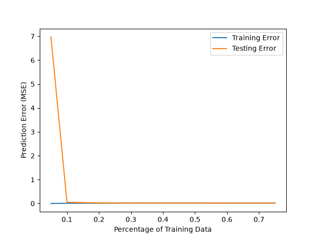
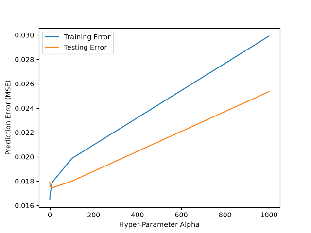
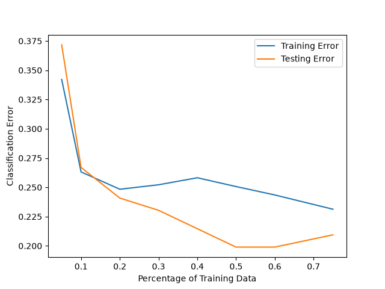
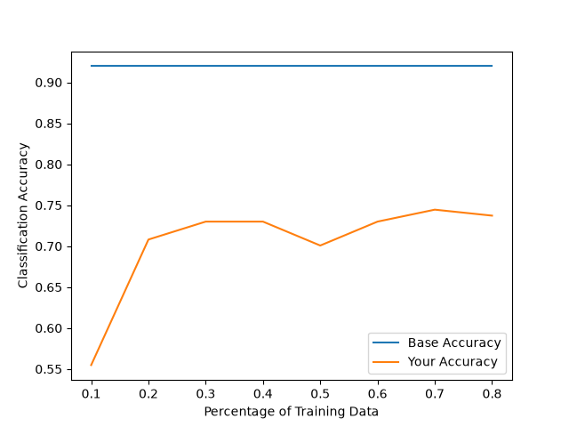
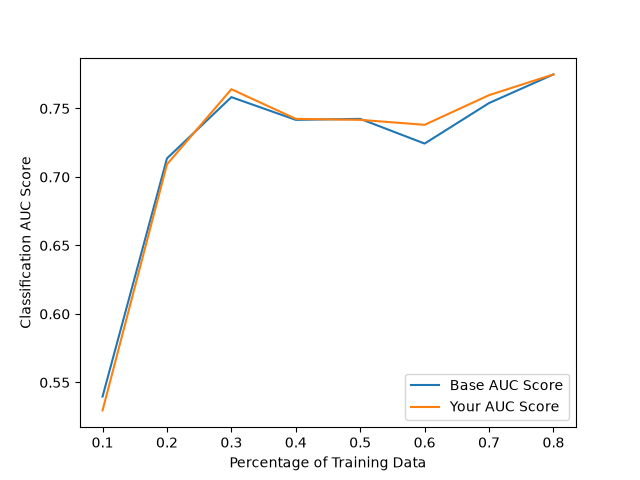
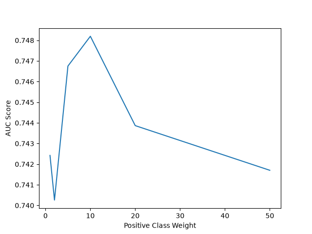

# CS4013/5013 Assignment 4

Edward Wages & Benjamin Wheeler

Fall 2026

*Figure 1*

*Figure 2*

Hyper-Parameter | Validation Error
---|---
0.001 | 0.01960027222344323
0.1 | 0.019265093361222847
10 | 0.01917641177885098
1000 | 0.03195100635941695
100000 | 0.055874409462089755

*Table 1*

*Figure 3*

*Figure 4*

*Figure 5*

*Figure 6*

