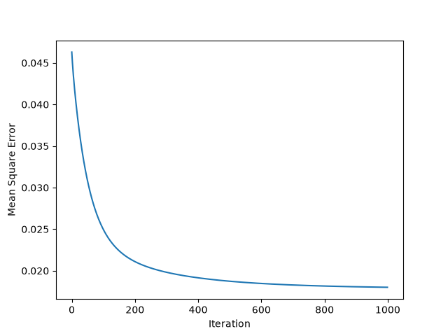
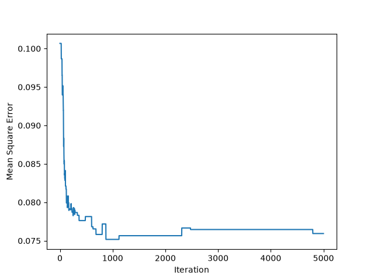
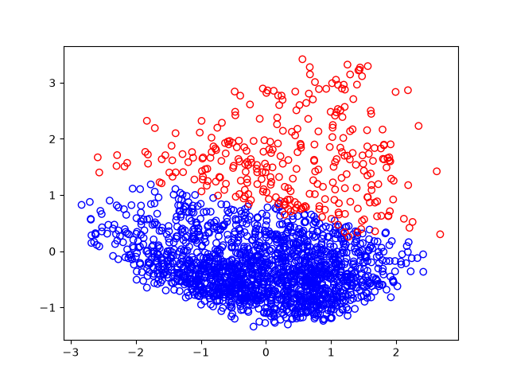
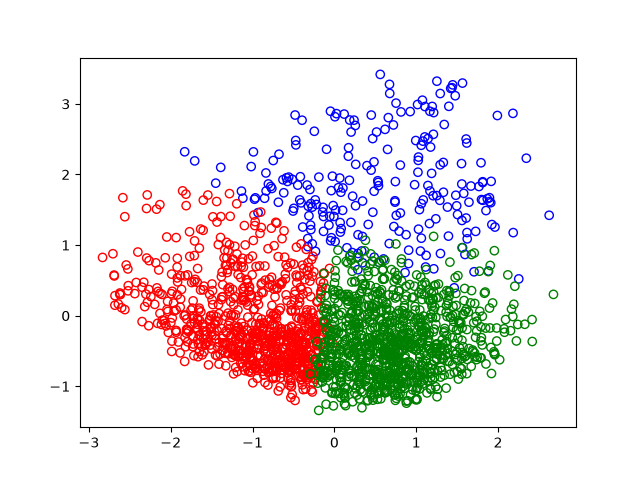
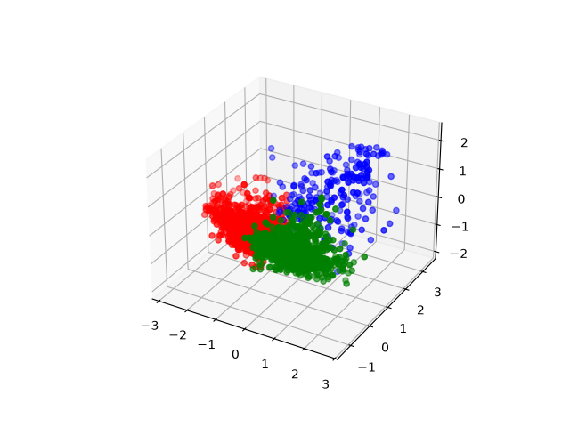
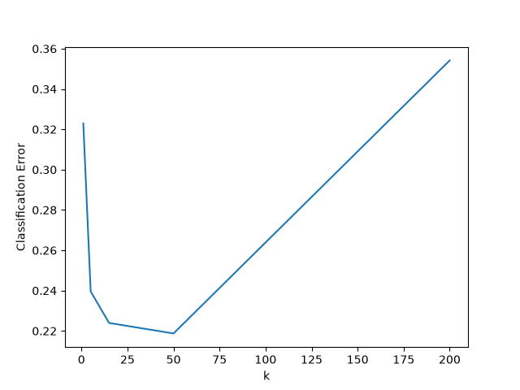
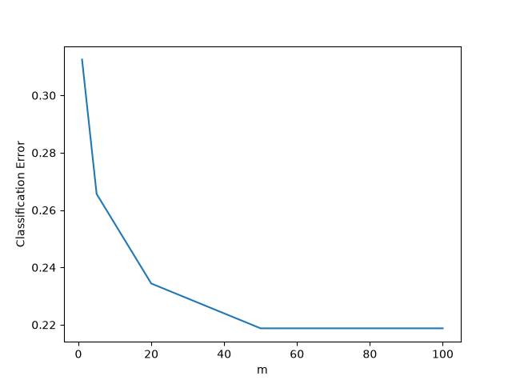

## Task 1

## Task 2

## Task 3

## Task 4

## Task 5

Entropy before the split; the table has 6 B and 4 A:  
$$ I\left(\tfrac{6}{10},\tfrac{4}{10}\right) = -0.6\log_2 0.6 - 0.4\log_2 0.4 = 0.971 $$

Each binary feature $F$ splits the examples into a child with $F=1$ and a child with $F=0$. The label entropy of each child is computed from that child's own B/A proportions. The remainder is the average of the child entropies, weighted by the fraction of examples in each child:  
$$ \mathrm{Rem}(F)=\sum_{i} \frac{|E_i|}{10}\, I\left(\tfrac{b_i}{|E_i|},\tfrac{a_i}{|E_i|}\right) $$

The gain is:  
$$ \mathrm{Gain}(F)=0.971-\mathrm{Rem}(F) $$

| Feature | $F=1$ | $F=0$ | Remainder | Gain |
|---|---|---|---|---|
| F1 | (5,2) | (1,2) | 0.880 | 0.091 |
| F2 | (4,2) | (2,2) | 0.951 | 0.020 |
| F3 | (2,3) | (4,1) | 0.847 | 0.125 |
| F4 | (3,2) | (3,2) | 0.971 | 0.000 |
| F5 | (4,2) | (2,2) | 0.951 | 0.020 |

### Remainders

$$ \mathrm{Rem}(F1)=\tfrac{7}{10}I\left(\tfrac57,\tfrac27\right)+\tfrac{3}{10}I\left(\tfrac13,\tfrac23\right)=0.7(0.863)+0.3(0.918)=0.880 $$

$$ \mathrm{Rem}(F2)=\tfrac{6}{10}I\left(\tfrac46,\tfrac26\right)+\tfrac{4}{10}I\left(\tfrac24,\tfrac24\right)=0.6(0.918)+0.4(1)=0.951 $$

$$ \mathrm{Rem}(F3)=\tfrac{5}{10}I\left(\tfrac25,\tfrac35\right)+\tfrac{5}{10}I\left(\tfrac45,\tfrac15\right)=0.5(0.971)+0.5(0.722)=0.847 $$

$$ \mathrm{Rem}(F4)=\tfrac{5}{10}I\left(\tfrac35,\tfrac25\right)+\tfrac{5}{10}I\left(\tfrac35,\tfrac25\right)=0.5(0.971)+0.5(0.971)=0.971 $$

$$ \mathrm{Rem}(F5)=\tfrac{6}{10}I\left(\tfrac46,\tfrac26\right)+\tfrac{4}{10}I\left(\tfrac24,\tfrac24\right)=0.6(0.918)+0.4(1)=0.951 $$

### Worked example

- $F3=1$ is students 03, 04, 07, 09 and 10, which gives 2 B and 3 A.
- $F3=0$ is students 01, 02, 05, 06 and 08, which gives 4 B and 1 A.

## Task 6

## Task 7

| | Basic Logistic Regression | Your Method |
|---|---|---|
| Group 1 Error | 0.2903 | 0.3065 |
| Group 2 Error | 0.3889 | 0.3611 |
| Error Gap | 0.0986 | 0.0547 |

The baseline fits one model to all students, so the model is tuned to the pattern that dominates the data. That pattern fits females better than males. The new method trains a separate model for each gender, using only that group’s training data. At test time each student is predicted by the model for their own group. Each group then gets its own decision boundary. The male error fell from 38.9% to 36.1% and the female error rose slightly from 29.0% to 30.6%. This cut the error gap by about 45%, from 9.9% to 5.5%.
